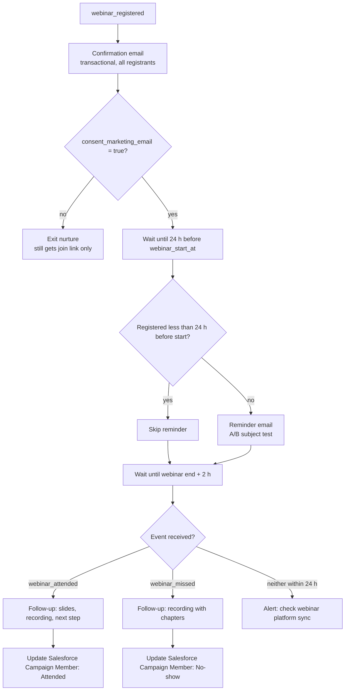

# Webinar nurture flow: build specification

A sample of how I document an automation before I build it: the logic, the edge cases and the tests. The webinar, data and domains are fictional. The structure follows Customer.io concepts (people, events, segments, event-triggered automations (formerly called campaigns), subscription topics, Liquid). It has not been built in a live Customer.io workspace yet.

## Goal

Turn webinar registrations into attended sessions, and attended sessions into a next step: a demo request or a trial of the weather API. Every registrant gets the information they need. Only people with marketing consent get the nurture.

## Data in

| Source | Path | What arrives |
|---|---|---|
| Web form | Segment `identify` | Email, first name, company, industry, country, `consent_marketing_email` |
| Webinar platform | Segment `track` | `webinar_registered`, `webinar_attended`, `webinar_missed` with `webinar_id` |
| Website | Segment `track` | `recording_viewed` |
| Salesforce | Two-way sync | `salesforce_lead_id`; Campaign Member status back to Salesforce |

All event and attribute names are in `tracking-plan.json`. A message may only use names listed there.

## Flow

## Messages

| Message | Trigger | Audience | Purpose |
|---|---|---|---|
| `confirm` | `webinar_registered` | Every registrant (transactional) | Join link, calendar file, time in the registrant's time zone |
| `reminder-24h` | 24 h before `webinar_start_at` | Consented registrants | Join link and one question to think about. A/B test on subject |
| `followup-attended` | `webinar_attended` | Consented attendees | Recording, slides, one clear next step |
| `followup-missed` | `webinar_missed` | Consented no-shows | Recording with chapter links |

## Edge cases

| Case | Handling |
|---|---|
| Registers twice for the same webinar | Campaign set to trigger once per person per `webinar_id`; second event only updates the attribute |
| Registers less than 24 h before start | Reminder skipped; confirmation carries the join link |
| Registers after the webinar started | Confirmation still sent; follow-up depends on the attended or missed event |
| Unsubscribes from the topic mid-flow | Subscription topic check on every nurture message; the person exits |
| No consent | Confirmation only (transactional). No reminder, no follow-up |
| Webinar time changes | New `webinar_start_at` arrives with an update event; the wait step reads the attribute at send time |
| Neither attended nor missed event arrives | Internal alert after 24 h; nothing is sent to the person |
| Missing first name | Every Liquid variable has a `default` fallback |
| Hard bounce | Customer.io suppresses the address; Salesforce field updated by sync |

## Salesforce

- Each webinar is a Salesforce Campaign. Member statuses: Registered, Attended, No-show.
- Status updates go back to Salesforce on the attended and missed events.
- MQL signal (to agree with Sales and RevOps, not decided here): attended plus a fit match on industry, or a recording view plus a pricing-page visit within 14 days.

## Testing before launch

1. Run the preflight checker on every message (`preflight/preflight.py`). No FAIL lines allowed.
2. Send test events for four test people: consented attendee, consented no-show, no consent, late registrant. Check that each gets exactly the messages in the table above.
3. Seed-list send to Gmail, Outlook and Apple Mail accounts, in light and dark mode.
4. Check that the Salesforce Campaign Member status changes for the two follow-up paths.
5. Agree the checklist with the campaign owner and record sign-off.

## Measures

- Registration to attendance rate, by source (UTM on the registration page).
- Reminder A/B test: click-to-join rate. Minimum 400 recipients per variant before a decision; otherwise record the result as directional only.
- Follow-up click rate and next-step conversions (demo request, API trial sign-up).
- Pipeline contribution: reported through the attribution tool, not from email clicks alone.
